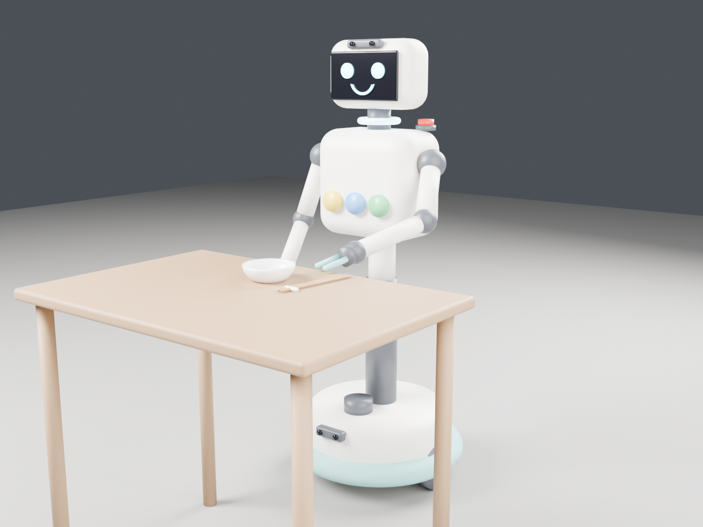

# Kawan: an open assistive robot for special-needs learners

*Kawan* means "friend" in Malay. This is a working name.

An open project to design an assistive robot for **non-verbal autistic
students in Singapore SPED schools**, with plans to support learners with
visual impairment and multiple disabilities later.

Status: **concept**, November 2026. Nothing has been built or tested with
students.



## Plan

| Track | What | When |
| --- | --- | --- |
| A | **Workstation coach**: a tabletop robot that coaches daily-living and job skills step by step, notices when a student needs more support, and goes quiet and alerts staff during a meltdown | First: useful within about a year |
| B | **Learning lab**: a low-cost open-source mobile robot with arms (XLeRobot / SO-101) that learns table-setting with chopsticks and tidying by demonstration, in a lab only | Alongside A |
| C | **Full-size robot** (the render): mobile base, lift mast, two arms, guide handle. Cooking through appliances; guiding to stairs, never carrying a person on them | After A and B prove out |

## Documents

- [Feasibility brief](docs/feasibility.md): design, safety, privacy, phased plan, market scan
- [Hardware, software and price breakdown](docs/bom.md)
- [Concept model](cad/concept_robot.py): Blender script; renders in [`renders/`](renders/)
- [Print guide for the coach base](docs/print-guide.md)
- [Publishing the lab site](docs/site-setup.md)

## Concept model

```bash
pip install bpy==5.2.4          # Blender as a Python module (Python 3.13)
SAMPLES=128 python cad/concept_robot.py
```

Or in Blender: open the **Scripting** tab, open `cad/concept_robot.py`, and
press **Run Script**. The scene is built so you can orbit it; renders are
written only when the script runs headless.

This is a proportions model for discussion. Printable parts will be made
separately in code-based CAD (build123d), with exact dimensions.

## Firm rules

- The robot never touches, blocks or restrains a person.
- No student photos, video or personal data in this repository or on the
  project site.
- The public cannot control a physical robot.
- Fully offline on the robot. No feature may depend on a cloud service
  staying in business.

## Licences (proposed)

Code: Apache-2.0 · Hardware: CERN-OHL-P-2.0 · Documentation and renders: CC BY 4.0

## Printable parts

- **Coach base v0.1** (fit test): electronics base, lid, table clamp, knob, pad.
  STL/STEP files are in [`cad/out/`](cad/out/), made by [`cad/coach_base.py`](cad/coach_base.py).
  How to print and assemble: [docs/print-guide.md](docs/print-guide.md).
