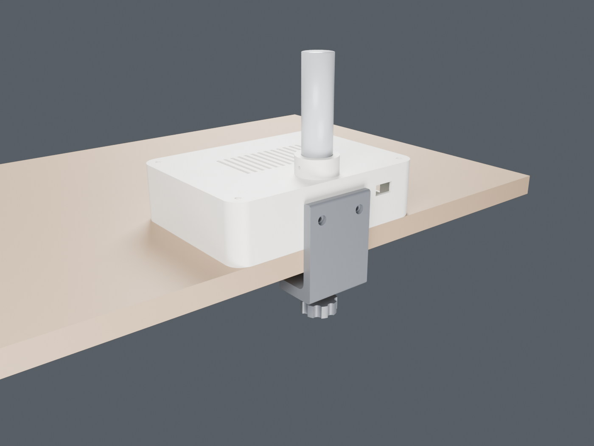
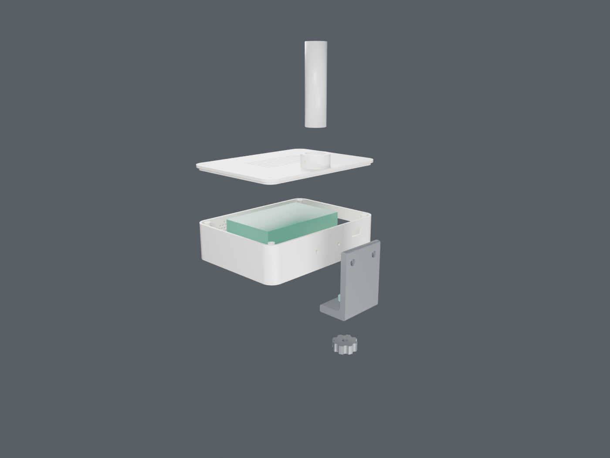

# Printing the coach base (fit test v0.1)

This first print checks size and fit: whether the board sits in its corner
fences, whether the lid screws line up, and whether the clamp grips a real
classroom table. It isn't the final enclosure.




## Files

STL files to print are in `cad/out/`. Matching STEP files are there too, for
anyone editing in Fusion, Onshape or FreeCAD.
To change a size, edit the parameters at the top of `cad/coach_base.py` and
re-run it:

```bash
pip install build123d
python cad/coach_base.py
```

| Part | Size (mm) | Material | Orientation on the plate | Settings |
| --- | --- | --- | --- | --- |
| `base.stl` | 240 × 180 × 60 | PETG | As modelled: floor on the bed | 3 walls, 15% gyroid. Supports **on** for the side window and the rear cable port (bridges up to 100 mm) |
| `lid.stl` | 240 × 180 × 24 | PETG | As modelled: flat plate on the bed, socket up | 3 walls, 15% gyroid, no supports |
| `clamp.stl` | 80 × 50 × 106 | PETG or PC | **On its side**, so the L shape lies flat on the bed. This makes it much stronger. | 6 walls, 40% gyroid |
| `knob.stl` | 39 × 39 × 14 | PETG | Flat | 4 walls, 30% infill |
| `pad_TPU.stl` | 24 × 24 × 6 | TPU 85–95A | Flat | 100% infill |

On the H3C you can print the base, lid, knob and pad as one multi-material
job. The clamp prints better on its own because of its orientation.

### In Bambu Studio

1. **File → Import → Import 3MF/STL/STEP…** and pick the files in `cad/out/`.
2. Choose the filament for each part (right-click → *Change filament*).
3. Rotate the clamp onto its side: select it, press **R**, rotate 90° about X
   or Y until the L shape lies flat, then **Lay on face** (F) on the large side.
4. Turn on supports for the base only (*Object → Support → Enable*, type
   *tree*).
5. **Slice**, check the preview and estimated time, then send to the printer.

## Hardware to buy

| Item | Qty | Used for |
| --- | --- | --- |
| M3 heat-set inserts (5 mm long, for a 4.0 mm hole) | 4 | Lid screw bosses |
| M3 × 10 countersunk screws | 4 | Lid |
| M5 × 20 socket head bolts | 2 | Clamp to base |
| M5 hex nuts | 2 | Captive in the base's rear wall |
| M8 × 50 hex bolt | 1 | Clamp screw |
| M8 hex nut | 1 | Captive in the clamp jaw |
| 32 mm OD tube, about 150 mm long | 1 | Neck stand-in. Aluminium or PVC conduit is fine for the test |
| M4 × 8 grub screw (optional) | 1 | Locks the neck in its socket |

You'll need a soldering iron with an insert tip to set the heat-set inserts.

## Assembly

1. Press the 4 heat-set inserts into the bosses at the base's corners.
2. Drop the M5 nuts into their hex pockets on the inside of the rear wall.
3. Push the M8 nut into the hex pocket under the clamp jaw. Press the M8
   bolt head into the knob, thread the bolt up through the jaw, and press
   the TPU pad onto the bolt tip.
4. Set the board on the four corner posts. Screw the lid on.
5. Put the base on the table with its rear face flush with the table edge.
   Bolt the clamp to the rear wall with the M5 bolts, then tighten the knob
   under the table.

## Fit-test checklist

- [ ] **Measure the real VENTUNO Q.** The model uses 160 × 100 mm from the
      published specs. Its mounting-hole positions weren't published, so it
      is held by its corners. Check that no connector or component sits
      where a corner fence is.
- [ ] Is the board snug but not forced? (Clearance is 0.5 mm; change
      `BOARD_CLEAR` if not.)
- [ ] Do the left-side window and rear cable port line up with the board's
      actual connectors? **These are placeholders** until the board arrives.
- [ ] Is there enough room above the board for its heatsink and fan? (There
      are about 20 mm.)
- [ ] Does the clamp grip your actual school tables? It fits tables
      **15–36 mm thick**. Measure the tables.
- [ ] Push hard on the clamped base from every side. Does anything flex or
      crack? If it does, switch the clamp to PC, or later to a bent aluminium
      bracket.
- [ ] Do the lid screws line up and the neck tube fit its socket?

Write down what you find, or open a GitHub issue with photos (**no students
in the photos**), and the next version will fix it.
